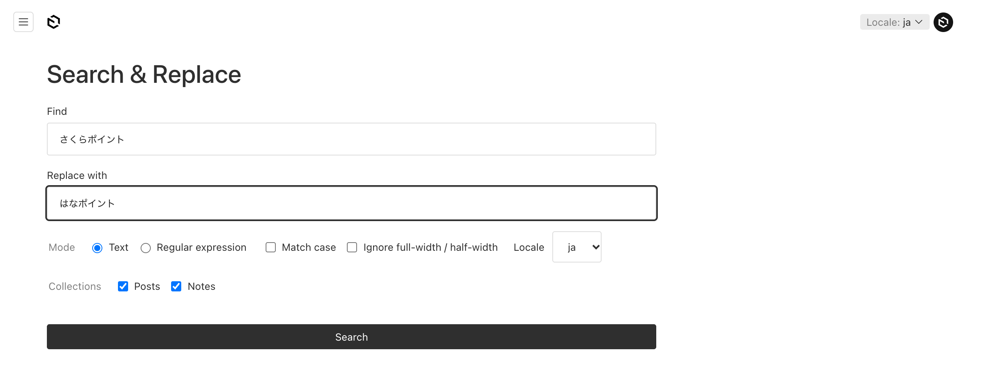
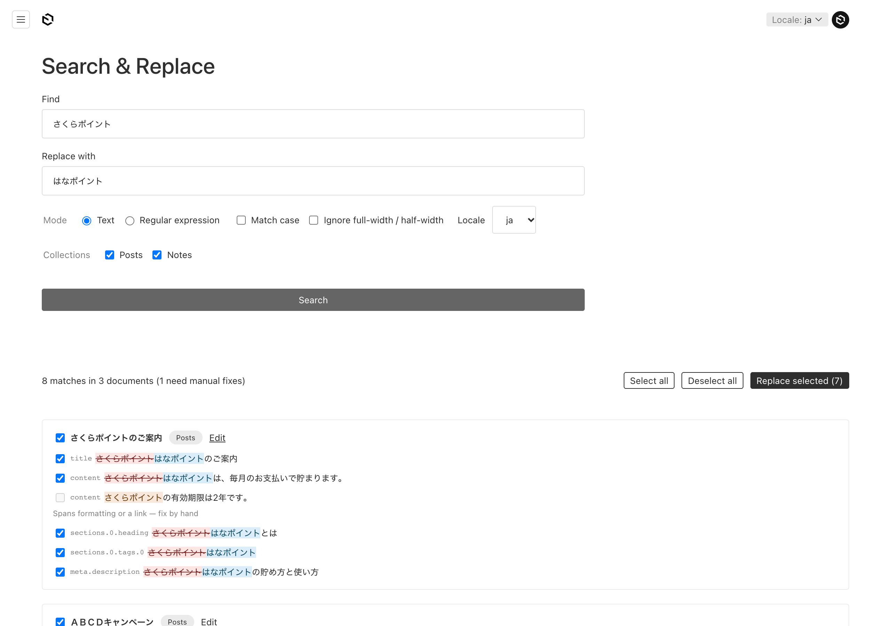
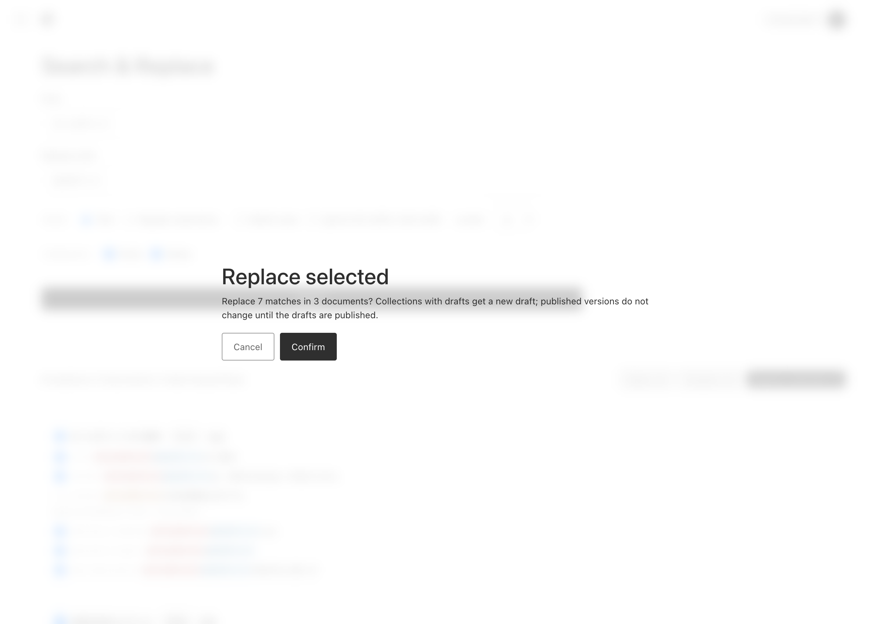
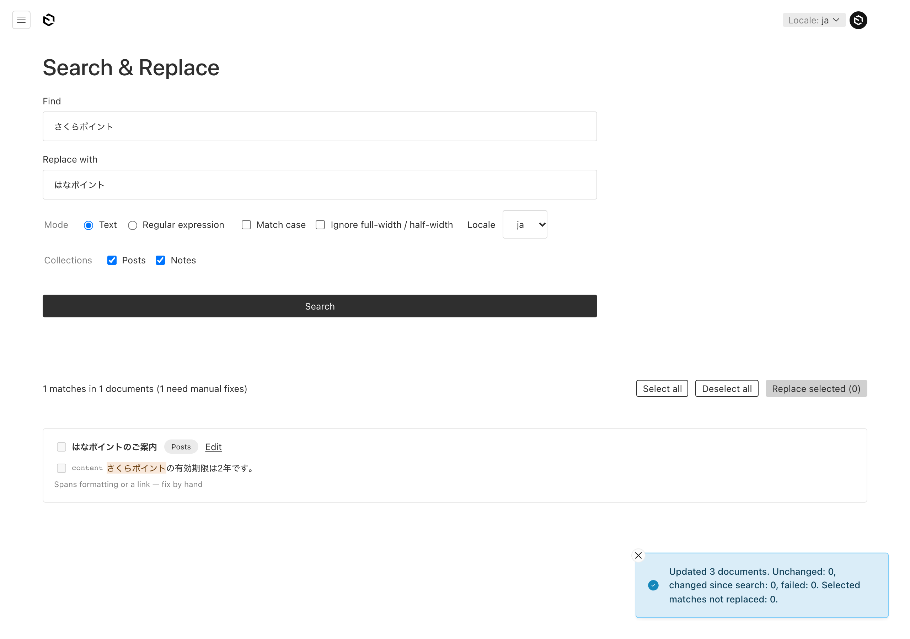
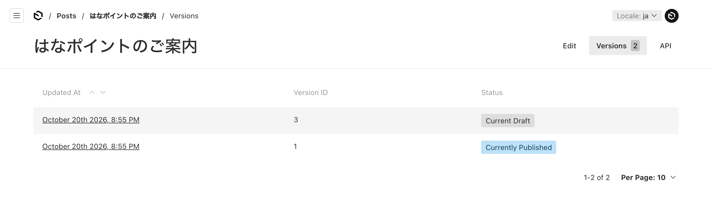
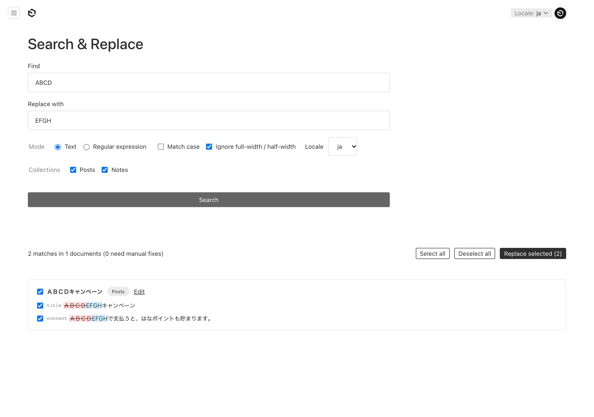

# Payload Search & Replace Plugin

Find and replace text across [Payload CMS](https://payloadcms.com) collections — plain text, textareas and Lexical rich text — with a preview of every change before anything is saved.

A fork of [`@payloadcms/plugin-search`](https://github.com/payloadcms/payload/tree/main/packages/plugin-search): its `search` collection becomes an index of every document's text, used to find candidates quickly. See [FORK.md](./FORK.md).

## Features

- **Search across collections** in `text`, `textarea`, `hasMany` text and Lexical `richText` fields, including fields inside groups, tabs, arrays and blocks
- **Preview** every match with its context and the replacement, then pick the ones to apply
- **Saves drafts**: on collections with drafts enabled, replacements are saved as a new draft and the published version stays as it is until the draft is published through your normal workflow
- **Keeps rich text formatting**: text is replaced inside each Lexical text node, so bold, links and other formats stay. A match that spans formatting boundaries is shown but left for you to fix by hand
- **Matching modes**: plain text (optionally case-sensitive), regular expressions (RE2 syntax, opt-in per user), and width-insensitive matching (NFKC) so `ＡＢＣ` matches `ABC` and `ｶﾞ` matches `ガ` — only the matched range is replaced
- **Respects access control**: every read and write runs with `overrideAccess: false` as the signed-in user, so collection, document and field access (tenants, departments, roles…) apply
- **One locale at a time**, without locale fallback
- **Admin view** at `/admin/search-replace`, with a nav link. English and Japanese

## Requirements

- Payload `^3.86.0`, Next.js `>=15.2.9`, React 19
- `@payloadcms/ui`, `@payloadcms/next` and `@payloadcms/translations` as direct dependencies, at the same version as `payload`
- Any Payload database adapter (tested with SQLite; written for PostgreSQL and MongoDB)

## Installation

```bash
pnpm add @fourdigit/payload-plugin-search-replace
```

```ts
// payload.config.ts
import { searchReplacePlugin } from '@fourdigit/payload-plugin-search-replace'

export default buildConfig({
  // ...
  plugins: [
    searchReplacePlugin({
      collections: ['pages', 'posts'],
      replace: {
        canUseRegex: ({ req }) => Boolean(req.user?.roles?.includes('admin')),
      },
    }),
  ],
})
```

Then regenerate the import map and, for existing content, build the index once:

```bash
pnpm payload generate:importmap
```

The index is filled when documents are saved. For documents that existed before the plugin was installed, run a reindex (see [Access to the index](#access-to-the-index)).

## Usage

Open **Search & Replace** from the admin nav, or go to `/admin/search-replace`.

### 1. Enter what to find



- **Find**: the text to look for. **Replace with**: the new text; leave it empty to delete the matches.
- **Mode**: plain text or a regular expression (only for users allowed by `replace.canUseRegex`).
- **Match case**, and **Ignore full-width / half-width** (see step 5).
- **Locale**: which locale's text to search and change. Other locales are left as they are.
- **Collections**: limit the search to some of the configured collections.

Press **Search**. Nothing is saved yet.

### 2. Check the preview



Each document is listed with every match, its field path, and the text before and after the change. Untick a match, or a whole document, to leave it out. **Edit** opens the document.

A match that crosses formatting or a link in rich text (here, `さくら` + **`ポイント`** in bold) is shown but can't be ticked: replacing it would lose the formatting, so it says *fix by hand*.

### 3. Replace



**Replace selected** asks for confirmation, then saves each document as the signed-in user, with that user's access rights.



The message counts what happened to each document: updated, unchanged, changed since the search (another edit came first; nothing was written, so search again), or failed. The search then runs again, so what's left is what still matches, like the match to fix by hand.

### 4. Publish the drafts



On collections with drafts, the replacement is a new draft and the published version stays as it is. Review it in the document's **Versions** tab and publish it through your usual workflow. The version history is also the record of what was replaced and by whom.

### 5. Full-width and half-width text



With **Ignore full-width / half-width**, `ABCD` also finds `ＡＢＣＤ`, and `ｶﾞ` finds `ガ`. Only the matched characters are replaced; the text around them keeps its width.

The screenshots come from the dev app (`dev/`) and can be regenerated with `node dev/screenshots.mjs` (see the comment at the top of the file).

## Options

All options of `@payloadcms/plugin-search` are accepted. Defaults that differ from upstream are marked.

| Option | Type | Default | |
|---|---|---|---|
| `collections` | `string[]` | — | Collections to index and search |
| `fields.exclude` | `string[]` | `['**.slug', '**.url']` | Glob patterns on the field path (names only, no array indices, e.g. `layout.content`). `*` matches one segment, `**` any number |
| `fields.include` | `({ collection, field, schemaPath }) => boolean \| undefined` | — | Decide per field. `undefined` falls back to `exclude` |
| `replace.access` | `({ req }) => boolean \| Promise<boolean>` | users who can open the admin panel | Who can open the view and call the endpoints. Document access still applies |
| `replace.canUseRegex` | `({ req }) => boolean \| Promise<boolean>` | nobody | Who can search with regular expressions |
| `replace.maxApplyDocs` | `number` | no limit | Most documents one apply request may change |
| `replace.disableAdminView` | `boolean` | `false` | Leave out the admin view and nav link; the endpoints stay |
| `syncDrafts` | `boolean` | **`true`** (upstream `false`) | The index has to hold draft text, since replacements work on drafts |
| `deleteDrafts` | `boolean` | **`false`** (upstream `true`) | |

## Access to the index

The `search` collection lists text from every indexed document, drafts included, across tenants and departments. So by default **nobody can read, update or delete it through the API** (upstream allows public reads), and its `content` / `contentRaw` fields are never readable, even if you open the collection up. Syncing and search & replace use the Local API and do not need API access.

To see the collection in the admin panel and use upstream's **Reindex** button, give your administrators access:

```ts
searchReplacePlugin({
  collections: ['pages', 'posts'],
  searchOverrides: {
    access: {
      read: isAdmin,
      update: isAdmin,
      delete: isAdmin,
    },
  },
})
```

Only give reindex to users who can read every indexed document: a reindex rebuilds the index with the documents the user can read.

## REST endpoints

The admin view uses these; you can call them yourself.

| Endpoint | Body | Returns |
|---|---|---|
| `GET /api/search-replace/capabilities` | — | `{ canUseRegex, collections, maxApplyDocs }` |
| `POST /api/search-replace/preview` | `{ find, replace?, mode?: 'text' \| 'regex', caseSensitive?, normalizeWidth?, locale?, collections? }` | `{ documents: [{ collection, id, title, updatedAt, matches: [{ id, fieldPath, before, text, after, replacement, replaceable, reason? }] }], totals }` |
| `POST /api/search-replace/apply` | the preview query plus `documents: [{ collection, id, matchIds, updatedAt? }]` | `{ results: [{ collection, id, status, appliedIds, skippedIds, message? }] }` |

`status` is `updated`, `unchanged`, `stale` (the document changed after the preview; nothing was written) or `error`. Match ids that were not replaced — changed since the preview, needing a manual fix, or kept by field-level update access — are listed in `skippedIds`.

## Limitations

- **Regular expressions use RE2 syntax** ([re2js](https://github.com/le0pard/re2js)): they run in linear time, so no pattern can stall the server, but backreferences (`\1`) and lookaround (`(?=…)`, `(?<=…)`) are not supported. Replacements support `$1`, `$<name>`, `$&` and `$$`.
- **Fields inside Lexical blocks** (`BlocksFeature` nodes) are not searched.
- **The preview returns every match at once.** Very common search terms across large collections make large responses.
- Searches containing `\`, and all regular expressions, read every document of the selected collections instead of narrowing with the index.
- A match that covers only part of a character NFKC expands (e.g. `平` in `㍻`) is shown but has to be fixed by hand.
- After saving, the plugin compares the saved value with the planned one. If your hooks reformat a field on save (trimming, adding data to rich text nodes), the match is reported as not replaced even though the change was saved.
- When the host uses localization, saving a document re-indexes it in every locale, because non-localized fields are indexed too.

## Development

```bash
pnpm install
pnpm dev            # dev app on http://localhost:3000 (dev@payloadcms.com / test)
pnpm test:int       # unit and integration tests (in-memory SQLite)
pnpm lint
```

`DATABASE_URL` in `dev/.env` picks the adapter: `postgres://…`, `mongodb://…`, or unset for SQLite.

## License

MIT. Includes code from `@payloadcms/plugin-search`, © Payload CMS, Inc. See [LICENSE.md](./LICENSE.md).
